# MITRE ATT&CK<sup>&reg;</sup> Heatmap

A custom visualization that turns search results into a MITRE ATT&CK or D3FEND matrix. Each technique is colored by a value from your search, such as detections, alerts or coverage, so gaps and hot spots are visible at a glance. After installing the app, *MITRE ATT&CK Heatmap* appears in the visualization picker in Search and in dashboards (Simple XML and Dashboard Studio).

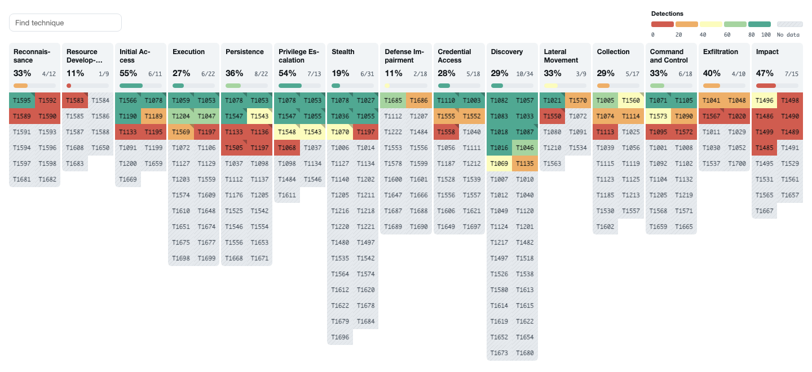

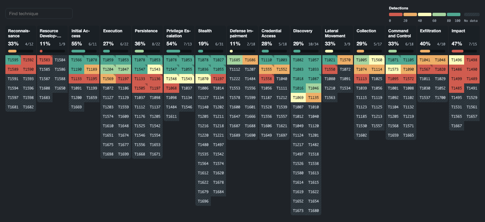

The app bundles **ATT&CK v20.0** (Enterprise, ICS, Mobile) and **D3FEND v1.6.0**. It can also import newer ATT&CK versions (see [Imported ATT&CK data](#imported-attck-data)). More about the versions: https://attack.mitre.org/resources/versions/ and https://d3fend.mitre.org/resources/

## Contents

- [Quick start](#quick-start)
- [Features](#features)
- [Search results](#search-results)
- [Using the heatmap](#using-the-heatmap)
- [Format menu](#format-menu)
- [Drilldowns](#drilldowns)
- [Dashboard Studio](#dashboard-studio)
- [Imported ATT&CK data](#imported-attck-data)
- [Troubleshooting](#troubleshooting)
- [Support](#support) and [Change log](#change-log)

## Quick start

1. Install the app. It has no dashboards of its own and needs no configuration.
2. Run a search that returns technique IDs and a number, for example:

   ```
   | stats count AS "Detections" first(description) AS description BY id
   | table id Detections description
   ```
3. Open the **Visualization** tab, choose **MITRE ATT&CK Heatmap**, and save the search to a dashboard.
4. Open the format menu to pick a matrix, a palette, the number of color bands and the other [options](#format-menu).

The animation below shows the heatmap loading: cells fade in and each tactic's coverage counts up. This happens once when the panel first loads, not on every refresh.

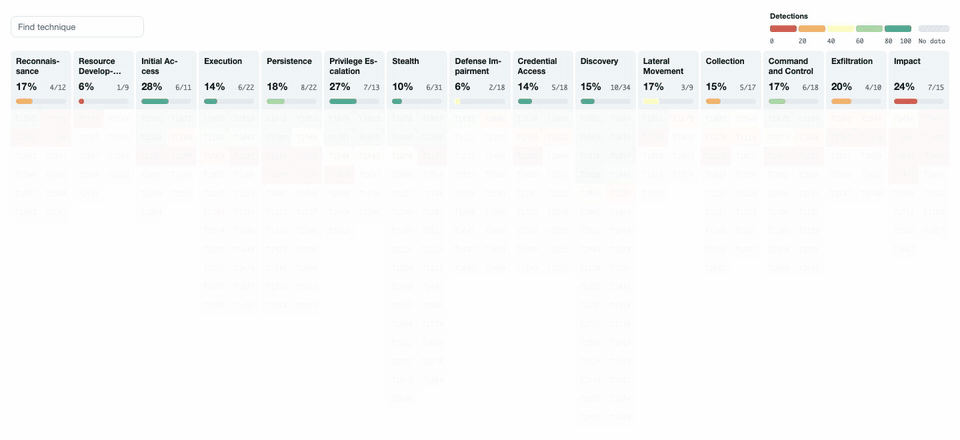

## Features

- **Four matrices.** ATT&CK Enterprise (with a filter for platforms such as Windows, Linux, macOS, Cloud and Containers), ICS and Mobile (Android, iOS), and D3FEND with its seven tactics.
- **Color bands.** The scale is split into 3, 5, 7 or 9 bands, shown in the legend with their value ranges. Colors blend perceptually (OKLCH), and the text on every cell keeps at least 4.5:1 contrast. Choose the *Default*, *Risk*, *Sequential blues* or *Viridis* palette, or set your own three colors.
- **Tactic summaries.** Each tactic header shows the share of its techniques that have a value, a count and a gauge. Hover it for the sum, average and highest technique.
- **Rich tooltips.** Description, value, band and rank, the other tactics the technique belongs to, and every sub-technique. Click a sub-technique to drill down on it, or click a cell to pin the tooltip.
- **Search.** Matches IDs, names, sub-technique names, descriptions and tactic names. Matches are ringed, everything else is dimmed.
- **Gaps stand out.** Techniques without a value are faintly hatched, and the legend's *No data* entry dims everything that has a value.
- **Status coloring.** Color by a text column (for example `covered`, `partial`, `gap`) instead of a number.
- **Roll-up.** Show the sum, max, average or count of sub-technique values on the parent technique.
- **ATT&CK Navigator export.** Download the current data as a Navigator layer.
- **Drilldown.** Clicks on techniques, sub-techniques and tactics set tokens you can use in dashboards.
- **Keyboard and light/dark.** One tab stop, arrow keys, and the colors follow the dashboard's theme. Search text, a pinned band, tactic or tooltip and the scroll position survive a refresh.
- **Wall mode.** An optional, purely decorative mode for display walls.

## Search results

The visualization needs a technique ID and a number, and optionally a description:

`| table <technique_id> <value> [description]`

OR

`| stats <aggregation> BY <technique_id>`

1. **Technique ID.** An ATT&CK technique or sub-technique ID such as `T1059` or `T1059.001`, or a D3FEND ID such as `D3-AA`. IDs that are not in the chosen matrix are ignored.
2. **Value.** A number, such as a count, sum or average.
3. **Description (optional).** Shown in the tooltip.

By default these are the first, second and third columns. To use other columns, name them in the format menu (see [Fields](#format-menu)).

Example, counting detections per technique:

```
index=notable
| stats count AS "Detections" first(rule_description) AS description BY mitre_technique_id
| table mitre_technique_id Detections description
```

Because only the column order matters, the field names are free. The name of the value column becomes the legend title.

A search with no results, rows whose IDs are not in the matrix, and rows without a number each show a message instead of an empty matrix.

### Sample data

The test version of the app (the one with the sample dashboards, built with `APP_ENV=test`) includes two dashboards, one classic and one Dashboard Studio, with a single heatmap fed by generated data. They are meant for trying out the options.

## Using the heatmap

### Tactics and techniques

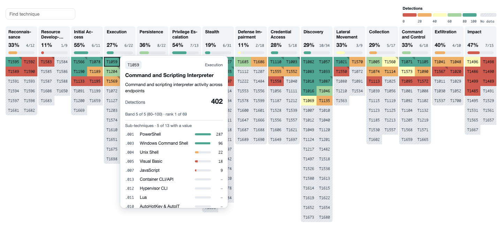

Each column is a tactic. Its header shows the coverage (the share of techniques with a value), the count, and a gauge in the color of the average. Hover or focus a cell, or use the keyboard, to see its tooltip: the description, the value, the band and the rank among all techniques with a value, the other tactics the technique is in, and its sub-techniques with their values. A small triangle in a cell's corner means some of its sub-techniques have values. Click a cell to pin its tooltip (click the cross or press Esc to close it). Click a tactic header to focus that tactic.

Show names under the IDs with *Display > Show > ID + name*. Long names end in an ellipsis; the tooltip has the full name.

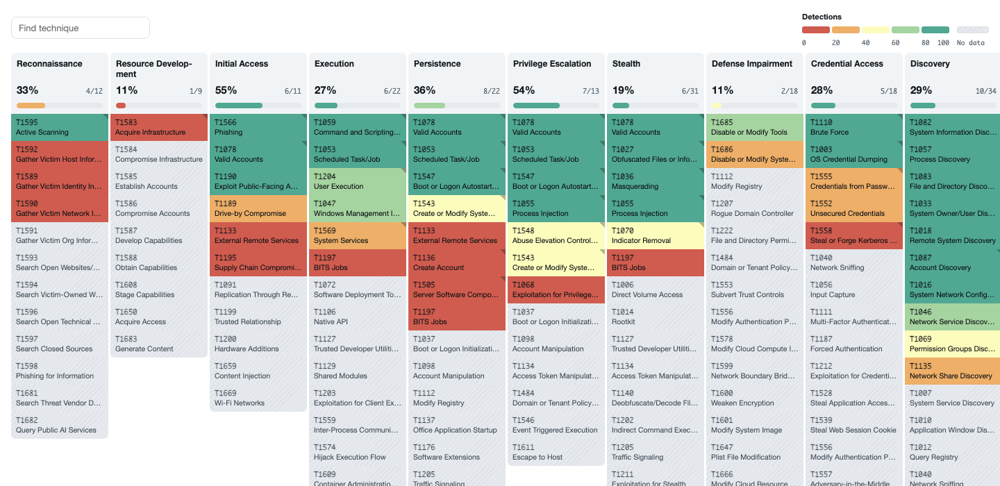

### Legend, search and gaps

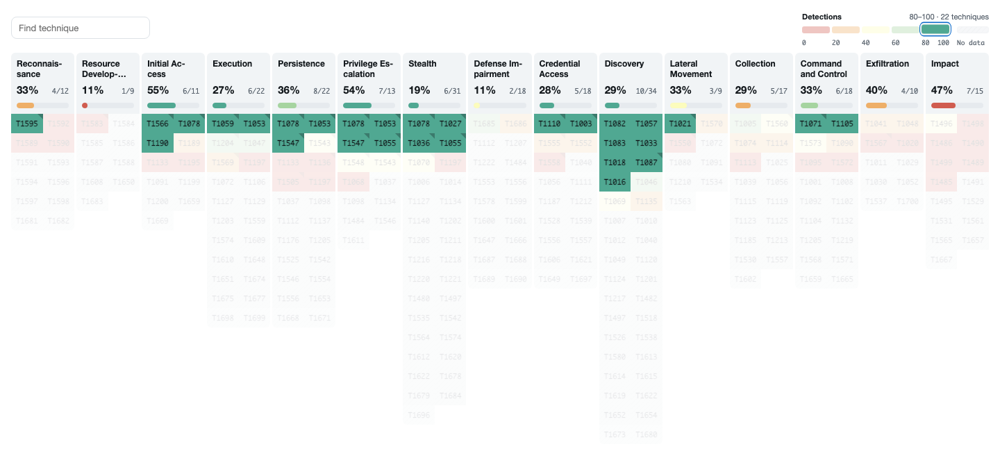

The legend lists the bands with their value ranges. Hover a band to dim everything outside it; click it to keep it pinned, and click again or press Esc to let go. *No data* dims every technique that has a value.

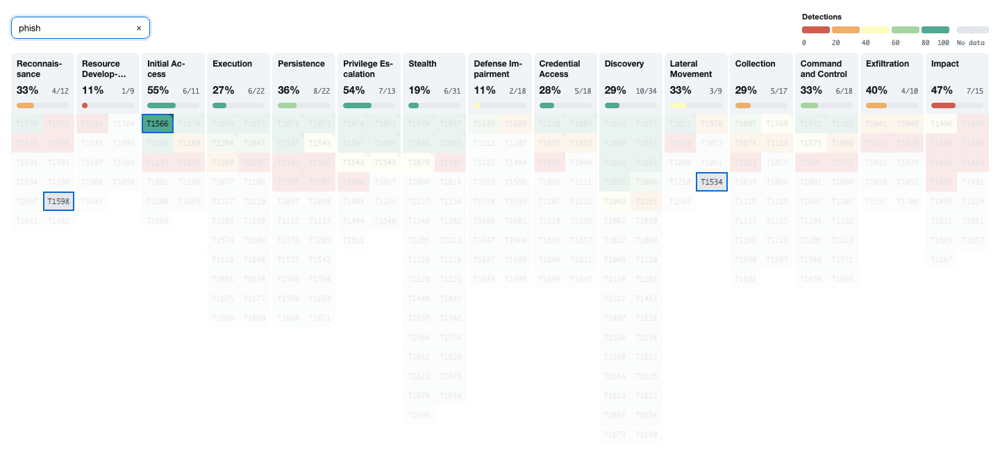

The search box matches as you type. The row above the matrix holds only the search box, the export button (when turned on) and the legend.

A walk-through of hovering, pinning, the legend and search:

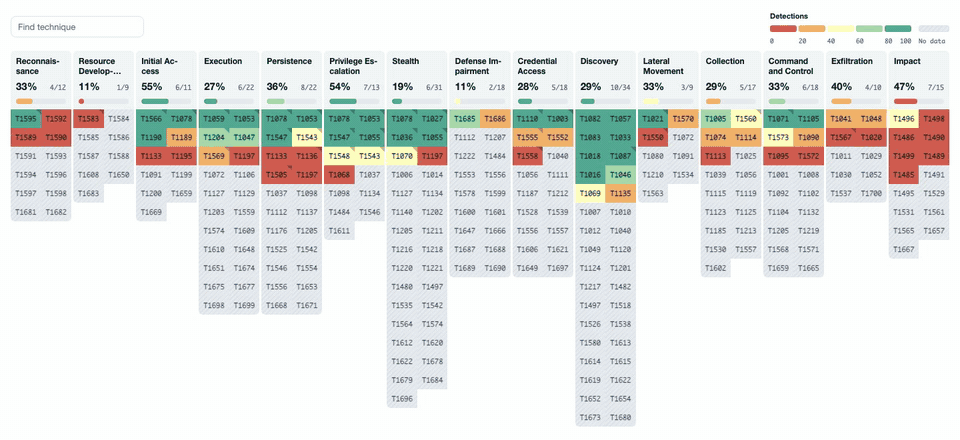

### Keyboard

The matrix is a single tab stop. Arrow keys move between cells, Home and End go to the first and last cell of a column, Enter selects (pins the tooltip and sends the drilldown), and Esc clears the search, a pinned band or tooltip.

### Status colors

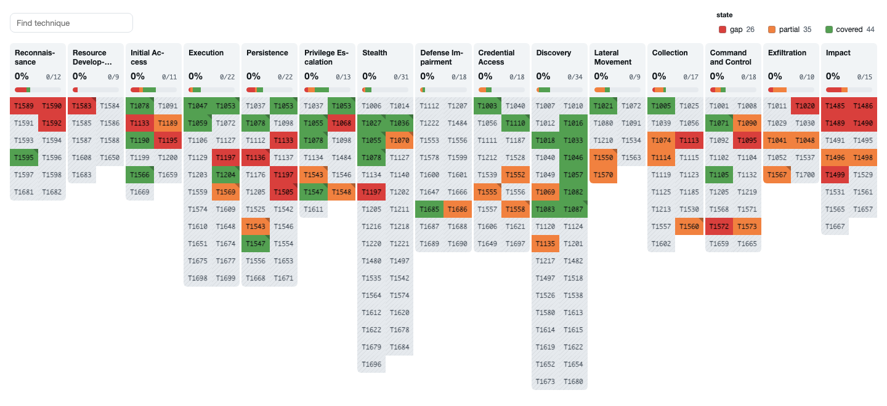

Set *Status field* to a text column and list colors in *Status colors*, for example `gap=#d93f3c, partial=#f1813f, covered=#53a051`. Cells take the color of their status (matched ignoring case; other statuses are gray), the legend lists each status with a count, and the number only appears in the tooltip. A parent technique without a status takes the first listed status among its sub-techniques when roll-up is on, so list the most important status first. *Sort by* gains *Status*.

```
| inputlookup coverage.csv
| table technique_id status description
```

### D3FEND

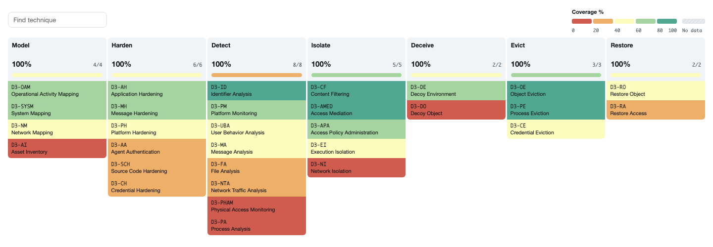

Choose *D3FEND* under *Matrix*. The columns are the seven defensive tactics (Model, Harden, Detect, Isolate, Deceive, Evict, Restore). The cells are D3FEND's techniques in the tactics that enable them, and each technique lists the more specific methods below it as sub-techniques, with their own IDs. D3FEND is always bundled; it is never imported.

### Roll-up and color bounds

- **Roll up sub-techniques** (*Scale*): when the search returns sub-technique IDs such as `T1059.001`, show the sum, max, average or count on the parent technique if it has no value of its own. Rolled-up cells have a dotted underline.
- **Color bounds** (*Scale*): *Manual* uses the lower and upper bound you type (the bands are of equal width). *From data* uses the lowest and highest value in the results, starting at 0 unless a value is negative, and then each band holds about the same number of techniques.

### Wall mode

For a display nobody is touching (*Display > Wall mode*, off by default): cells twinkle, and tactic names and figures scramble and resolve now and then. It carries no information. It pauses while anyone searches, hovers or pins something, when the browser tab is hidden, and when the browser asks for less motion.

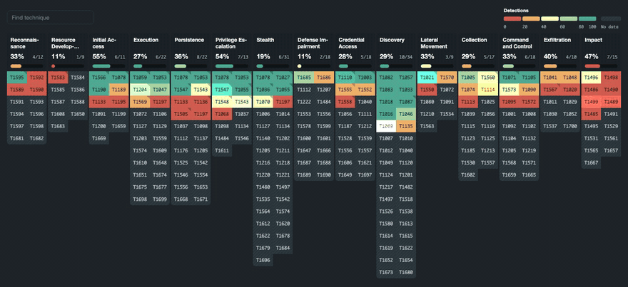

### Export to ATT&CK Navigator

Turn on *Export > Export button* to add a button that downloads the current data as an [ATT&CK Navigator](https://mitre-attack.github.io/attack-navigator/) layer (format 4.5): values become scores, descriptions become comments, and status colors and the legend are kept. Not available for D3FEND.

## Format menu

| Section | Option | What it does | Default |
|---|---|---|---|
| Data | Matrix | The matrix and platform: D3FEND; Enterprise (all, Containers, Cloud, ESXi, Linux, macOS, Network Devices, PRE, Windows); ICS; Mobile (all, Android, iOS) | Enterprise - All |
| Data | Matrix data | *Bundled* or *Imported* (see [Imported ATT&CK data](#imported-attck-data)) | Bundled |
| Data | ATT&CK version | With imported data, a version such as `19.1`, or `19` for the newest 19.x. Blank is the newest | blank |
| Data | ID field, Value field, Description field, Status field | Names of the columns to use instead of the first, second and third. Matched exactly, then ignoring case. A name that is not in the results is shown as an error listing the available fields | blank |
| Display | Show | *ID*, or *ID + name* | ID |
| Display | Sub-techniques | Show sub-techniques in the tooltip and count them in each tactic | Yes |
| Display | Hide empty | Hide techniques and tactics that have no value | No |
| Display | Sort by, Sort order | Value, Name, ID or Status; ascending or descending | Value, Descending |
| Display | Search bar | Show the search box | Yes |
| Display | Wall mode | See [Wall mode](#wall-mode) | No |
| Colors | Palette | *Default* and *Risk* use the three colors below (*Risk* reverses them: low is good, high is bad); *Sequential blues* and *Viridis* have their own | Default |
| Colors | Low, Middle, High color | Used by *Default* and *Risk* | #B63457, #FCFCBD, #22908D |
| Colors | Color bands | 3, 5, 7 or 9 | 5 |
| Colors | Status colors | `name=#color, ...` | blank |
| Scale | Roll up sub-techniques | None, Sum, Max, Average, Count | None |
| Scale | Color bounds | Manual or From data | Manual |
| Scale | Lower bound, Upper bound | The ends of the scale when Color bounds is Manual | 0, 100 |
| Export | Export button | Adds the Navigator export button | No |

Options that are not set in a dashboard use these defaults, in classic dashboards and in Dashboard Studio alike.

## Drilldowns

Clicking a technique, a sub-technique or a tactic header sets tokens that a dashboard can use. In a classic dashboard use `$row.<token>$`; in Dashboard Studio use `$row.<token>.value$`.

| Token | Value |
|---|---|
| `mtr_sub-technique_id`, `mtr_sub-technique_name`, `mtr_sub-technique_value`, `mtr_sub-technique_status` | The selected sub-technique |
| `mtr_technique_id`, `mtr_technique_name`, `mtr_technique_value`, `mtr_technique_status` | The selected technique, either by clicking it or one of its sub-techniques |
| `mtr_tactic_id`, `mtr_tactic_name`, `mtr_tactic_value` | The tactic of the selected technique, or the tactic itself when its header is clicked |

The status tokens are only set when a Status field is set. A value that does not apply to a click is not set, so the token stays unset.

Tactic names and IDs come from the matrix in use. A newer ATT&CK version can rename tactics (v20 replaced *Defense Evasion* with *Stealth* and *Defense Impairment* for Enterprise), and D3FEND tactic IDs look like `d3f:Harden`. Dashboards that match on tactic names need updating when the version changes.

## Dashboard Studio

The heatmap can be added to a Dashboard Studio dashboard (Add chart > Custom visualizations). Studio runs it inside a restricted frame, which changes a few things:

- **Tokens** are `$row.mtr_technique_id.value$` and so on, as above.
- **Options** that are not set in the dashboard use the defaults listed above.
- **Export button:** the browser does not let the frame download files, so the export shows the layer in a box to copy.
- **Technique links** in tooltips are shown as text (the frame cannot open new windows).
- The heatmap follows the dashboard's own light or dark theme.
- Trellis and scheduled email export are not available for custom visualizations in Studio.
- Each panel is its own frame, so panels do not share cached matrix data.

## Imported ATT&CK data

MITRE publishes new ATT&CK versions more often than this app is released. The app can download them itself. This is optional, and the bundled data is used until you set it up.

1. Enable the scripted input `bin/import_matrices.py` (Settings > Data inputs > Scripts). It runs weekly and writes one event per changed matrix to the index named in the `mitre_attck_matrix_index` macro (`index=main` by default).
2. Enable the report *MITRE ATT&CK - update matrix collection* (Settings > Searches, reports, and alerts: enable it, then Edit > Edit Schedule, for example weekly after the input runs). It copies the events into the `mitre_matrix` KV Store collection that the heatmap reads.
3. Set *Matrix data* to *Imported* in the format menu. *ATT&CK version* optionally pins a version.

The host running the input needs HTTPS access to `raw.githubusercontent.com`. Proxy, mirror and limit settings are in `mitre_attck_import.conf` (copy it to `local/` to change them). If no usable imported data exists, the bundled data is drawn with a note saying so.

In Splunk Cloud, scripted inputs run only where the platform allows them (for example on an Inputs Data Manager); if you cannot run the input, keep *Matrix data* on *Bundled*.

## Troubleshooting

- **The matrix is empty or shows a message.** Check that the search returns rows, that the first column holds IDs that exist in the chosen matrix (for example `T1059`, not `Command and Scripting Interpreter`), and that the second holds a number. The message names which of these failed.
- **A field name error.** The *ID field*, *Value field*, *Description field* or *Status field* option names a column that is not in the results. The error lists the columns that are.
- **Everything is one color.** With *Manual* color bounds, values outside the lower and upper bounds take the end colors. Raise the upper bound or switch to *From data*.
- **Sub-technique values do not show on their techniques.** Turn on *Roll up sub-techniques*.
- **Dashboard Studio drilldown tokens are empty.** Use `$row.mtr_technique_id.value$`, with `.value`.
- **The imported data is not used.** Check `| inputlookup mitre_matrix | table matrix version imported_at` returns rows, and that *Matrix data* is *Imported*.

## Support

This app is not supported on Internet Explorer. Please report issues at https://github.com/alatif113/mitre_attck_heatmap/issues

## Change Log

### v1.11.0
- D3FEND now follows the current ontology, as the D3FEND website draws it: seven tactic columns (Model, Harden, Detect, Isolate, Deceive, Evict, Restore), 30 techniques in them, and 241 sub-techniques under their techniques, shown with their own IDs. Before, each technique was its own column and no sub-technique attached. Dashboards that match on D3FEND tactic names or IDs in drilldown tokens need updating (tactic IDs are now `d3f:Model`, `d3f:Harden`, ...)
- Two sample dashboards, one classic and one Dashboard Studio, each with a single heatmap fed by generated sample data (in the test package only)
- Default panel height is now 1200 pixels (it was 2700)
- New look: flat tactic headers with a coverage figure and gauge, connected fixed-height cells, hatching for techniques with no value, and tooltips and a legend in Splunk's light and dark colors
- Colors are now split into 3, 5, 7 or 9 bands (*Color bands*, 5 by default) with bands that follow the data when the bounds come from it, and blend perceptually; new *Palette* option (Default, Risk, Sequential blues, Viridis)
- New legend: value bands with a *No data* entry, hover to dim, click to pin
- New tooltip: description, band and rank, other tactics, and every sub-technique (clickable); sub-technique cells are no longer drawn in a popover
- Search now finds sub-technique names, descriptions and tactic names; the row above the matrix is just the search box, the export button and the legend
- Keyboard navigation, focusable tactic headers, and a message for no results, ids that do not match the matrix, and rows without values
- Search text, filter, pinned band/tactic/tooltip and scroll position now survive a refresh
- Format menu reorganized (Data, Display, Colors, Scale, Export); the legend title is always the value field's name; sub-techniques are listed in the tooltip
- New *Wall mode* switch (*Display*), now the only animation setting: twinkling cells and scrambling tactic headers for display walls
- Changed defaults: *Sort by* Value, *Descending* (was ascending)
- Removed from the menu (still read if a saved dashboard sets them): *Legend title*, *Other status color*, *Lower bound from data*, *Technique's own value*, the Navigator layer name and version. Removed: *Duration*, and the *Animate* switch with the sweeping highlight. Cells now always fade in and the percentages count up when the panel first loads (not on refreshes, and not when the browser asks for less motion)
- Updated the bundled data to ATT&CK v20.0
- Added an optional scripted input and saved search that import newer ATT&CK versions, with *Matrix data* and *ATT&CK version* options
- Added the Fields options to map result columns by name
- Added *Roll up sub-techniques*, *Color bounds: From data*, status-based coloring and an ATT&CK Navigator export button
- Fixed: Enterprise tactic order for ATT&CK v20, several dashboards on one page affecting each other, "Hide null" removing sub-techniques that have values, the legend for non-zero lower bounds, zero and decimal values in tooltips, searching for names with `&`, the animation loop multiplying on refresh, one click firing many drilldowns, and several Platform options that showed an empty matrix
- Fixed: legend text built from field names is now escaped
- Narrow or short panels now scroll (sideways and up and down) instead of squeezing the columns; a column is never narrower than one cell, and cells have minimum and maximum widths that differ for IDs and names
- Removed the unused *Theme* option; the heatmap uses the theme of the dashboard it is in
- Dashboard Studio: defaults now match classic dashboards, unset drilldown values are no longer sent as text "undefined", the imported-data read works inside Studio's frame, and the export falls back to a copy box

### v1.9.0
- Added an optional search bar, enabled through the format menu, to quickly highlight techniques based on their ID or name
- Updated to use ATT&CK v15.1 and D3FEND v0.15.0

### v1.8.0
- Added MITRE D3FEND Matrix
- Updated Enterprise, Mobile, and ICS matrices

### v1.7.3
- Updated to use ATT&CK v14

### v1.7.0
- Added ability to toggle sub-techniques on/off via the visualization format menu.
- Added ability to enable an animation on the heatmap, highlighting techniques from lowest to highest values within a given duration. 
- Fixed bug where sorting by value or technique name was not working correctly.

### v1.6.1
- Added ability to select matrix type via the visualization format menu.
- Added support for sub-techniques

## LICENSE from the MITRE Corporation (MITRE)

Both MITRE ATT&CK<sup>&reg;</sup> and ATT&CK<sup>&reg;</sup> are registered trademarks of The MITRE Corporation.

The MITRE Corporation (MITRE) hereby grants you a non-exclusive, royalty-free license to use ATT&CK Evaluations for research, development, and commercial purposes. Any copy you make for such purposes is authorized provided that you reproduce MITRE's copyright designation and this license in any such copy.

"(C) 2018 The MITRE Corporation. This work is reproduced and distributed with the permission of The MITRE Corporation."

DISCLAIMERS
MITRE does not claim ATT&CK enumerates all possibilities for the types of actions and behaviors documented as part of its adversary model and framework of techniques. Using the information contained within ATT&CK to address or cover full categories of techniques will not guarantee full defensive coverage as there may be undisclosed techniques or variations on existing techniques not documented by ATT&CK.

ALL DOCUMENTS AND THE INFORMATION CONTAINED THEREIN ARE PROVIDED ON AN "AS IS" BASIS AND THE CONTRIBUTOR, THE ORGANIZATION HE/SHE REPRESENTS OR IS SPONSORED BY (IF ANY), THE MITRE CORPORATION, ITS BOARD OF TRUSTEES, OFFICERS, AGENTS, AND EMPLOYEES, DISCLAIM ALL WARRANTIES, EXPRESS OR IMPLIED, INCLUDING BUT NOT LIMITED TO ANY WARRANTY THAT THE USE OF THE INFORMATION THEREIN WILL NOT INFRINGE ANY RIGHTS OR ANY IMPLIED WARRANTIES OF MERCHANTABILITY OR FITNESS FOR A PARTICULAR PURPOSE.
